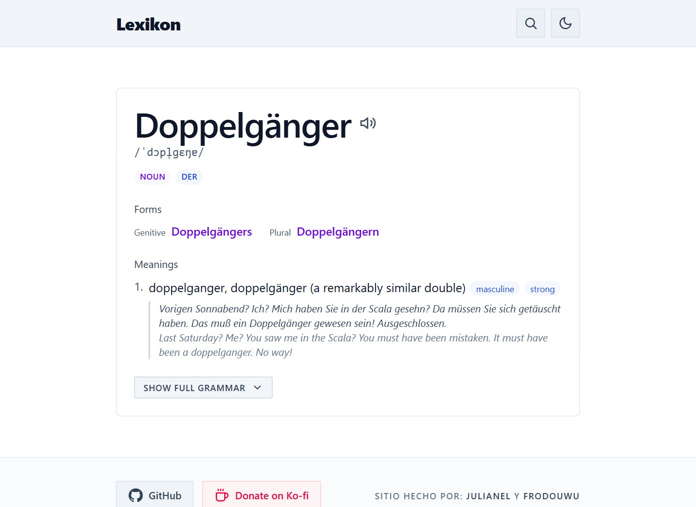
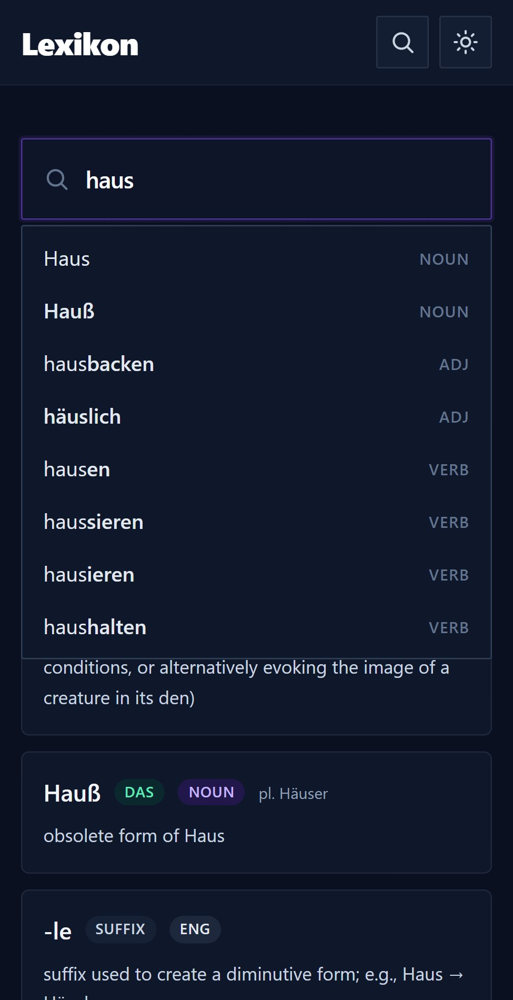

# Lexikon

A minimalist, ad-free **German → English dictionary**. Search-first UI, as-you-type
suggestions, umlaut/ß folding, and rich entry pages (IPA and native-speaker audio,
morphology, senses, examples and relations).

[](https://github.com/julianel5/Lexikon/actions/workflows/ci.yml)
[](https://lexikon.up.railway.app)

<p align="center">
  
  
</p>

```
kaikki.org German JSONL  ──►  ingest/ingest.py  ──►  data/dictionary.db  ──►  server (Hono)  ──►  web (React)
       (~1 GB dump)             folding + extract        optimized SQLite        REST API          search UI
```

## Stack

| Layer     | Tech |
|-----------|------|
| Ingest    | Python 3 (stdlib only, optional `tqdm`) → SQLite |
| API       | Node.js + [Hono](https://hono.dev) + `better-sqlite3` (read-only) |
| Frontend  | React 18 + Vite 5 + TypeScript + Tailwind CSS v4 |
| Data      | [kaikki.org](https://kaikki.org) post-processed German Wiktionary dump |

## Repository layout

```
.
├── ingest/            # Python pipeline: JSONL dump -> SQLite
│   ├── ingest.py
│   ├── requirements.txt
│   └── fixtures/      # small regression fixture
├── data/              # build output (gitignored, regenerate)
│   ├── raw/           # downloaded dump
│   └── dictionary.db
├── server/            # Hono + better-sqlite3 API
│   ├── Dockerfile
│   └── src/{index,db,fold}.ts
├── web/               # React + Vite + Tailwind UI
│   ├── Dockerfile
│   └── src/
│       ├── components/  # Search, SearchBar, ResultCard, EntryView, Header, Footer...
│       └── lib/         # api, search/autocomplete/entry hooks, routing, theme, audio
├── deploy/            # nginx config used by web/Dockerfile
├── docs/              # screenshots
└── .github/           # CI, issue forms, PR template, dependabot
```

## Prerequisites

- **Python 3.10+** (built with 3.13)
- **Node.js 20+** (built with 24)

## Quick start

### 1. Build the database

```bash
python -m pip install -r ingest/requirements.txt

# Download the source dump (~1 GB)
curl -L -o data/raw/kaikki.org-dictionary-German.jsonl \
  https://kaikki.org/dictionary/German/kaikki.org-dictionary-German.jsonl

# Build data/dictionary.db (~100 s, ~467 MB)
python ingest/ingest.py data/raw/kaikki.org-dictionary-German.jsonl -o data/dictionary.db
```

Ingest options:

| Flag | Description | Default |
|------|-------------|---------|
| `input` | path to the kaikki JSONL dump (positional) | — |
| `-o, --output` | output SQLite path | `data/dictionary.db` |
| `-b, --batch` | rows per insert transaction | `5000` |
| `--no-verify` | skip post-build sample lookups | off |

### 2. Run the API

```bash
cd server
npm install
npm run dev      # tsx watch, http://localhost:3000
```

### 3. Run the web app

```bash
cd web
npm install
npm run dev      # http://localhost:5173
```

Open <http://localhost:5173> and type a word (e.g. `Haus`, `sprechen`, `schoen`).

## How search works

Every indexed key is stored under three normalizations, so a query matches no
matter how the umlaut/ß is typed. The exact same folding is applied at query
time in `server/src/fold.ts` and at build time in `ingest/ingest.py`.

| kind | name | transform | `schön` → |
|------|------|-----------|-----------|
| 0 | exact | NFC + lowercase | `schön` |
| 1 | translit | ä→ae, ö→oe, ü→ue, ß→ss | `schoen` |
| 2 | strip | ä→a, ö→o, ü→u, ß→s | `schon` |
| 3 | english | content word of a gloss (reverse search) | `to go` → `go` |

Kinds 0-2 are always inserted, even when they coincide, so `Fuß` is
findable as `fuss`, `fus` and `fuß`. Results are ordered `kind` ascending, so
exact matches rank before transliterated/loose ones, and **German matches always
come before English ones**.

**Reverse search (kind 3).** The ingest also indexes the content words of every
gloss, so an English word finds the German entries that translate it (`house` →
*Haus*). Qualifiers in parentheses, stopwords and glosses that only describe the
word ("alternative spelling of …") are skipped. For kind 3 the `exact_form`
column is a relevance score (4 = a whole translation of the first sense, 3 = a
whole translation of a later sense, 2 = a word of the headline glosses,
1 = a mention further down); ties are broken by how many senses and examples the
entry documents. Kind 3 keys are never used for autocomplete. Inflected pages redirect to
their lemma instead of being stored as separate entries.

## API reference

Base URL: `http://localhost:3000`

### `GET /api/health`

```json
{ "status": "ok", "entries": 102740, "searchKeys": 3788997, "dbPath": "…/data/dictionary.db" }
```

### `GET /api/suggest?q={query}&limit={n}`

Folded lookup across the four key kinds (German exact/translit/strip, then English),
joined with entry metadata. Each result's `kind`/`match` says how it was found; kind 3
(`"english"`) means the German word was found through its English translation.

```bash
curl "http://localhost:3000/api/suggest?q=schoen"
```

```json
{
  "query": "schoen",
  "folded": { "exact": "schoen", "translit": "schoen", "strip": "schoen" },
  "count": 7,
  "results": [
    {
      "id": 866,
      "word": "schön",
      "pos": "adj",
      "gender": null,
      "article": null,
      "plural": "schöne",
      "snippet": "beautiful, lovely, pretty, handsome",
      "kind": 1,
      "match": "translit",
      "exactForm": true
    }
  ]
}
```

### `GET /api/autocomplete?q={text}&limit={n}`

Headword suggestions for what is being typed (prefix match, folded like search, so
`madch` and `mädch` both find *Mädchen*). Ranked: exact match first, single words before
phrases, then by how well documented the entry is. `limit` defaults to 8 (max 15).

```bash
curl "http://localhost:3000/api/autocomplete?q=ver&limit=3"
```

```json
{
  "query": "ver",
  "suggestions": [
    { "id": 1994, "word": "verstehen", "pos": "verb" },
    { "id": 22697, "word": "versichern", "pos": "verb" },
    { "id": 56111, "word": "verballhornen", "pos": "verb" }
  ]
}
```

### `GET /api/entry/:id`

Full stored entry as JSON (forms, senses, examples, sounds, relations).
Returns `404` for an unknown id and `400` for a non-numeric id.

```bash
curl "http://localhost:3000/api/entry/866"
```

## Configuration

### Server (`server/`)

| Env | Description | Default |
|-----|-------------|---------|
| `PORT` | HTTP port | `3000` |
| `HOST` | bind address | `0.0.0.0` |
| `DB_PATH` | path to the SQLite database | `../data/dictionary.db` |
| `CORS_ORIGIN` | comma-separated allowed origins (`*` to allow all) | `http://localhost:5173,http://127.0.0.1:5173` |

### Web (`web/`)

| Env | Description | Default |
|-----|-------------|---------|
| `VITE_API_BASE` | API base URL | `http://localhost:3000` |

## Database schema

```sql
CREATE TABLE entries (
  id     INTEGER PRIMARY KEY,
  word   TEXT NOT NULL,
  pos    TEXT NOT NULL,
  gender TEXT,
  data   TEXT NOT NULL            -- JSON blob: forms, senses, IPA, relations…
);

CREATE TABLE search_keys (
  key        TEXT    NOT NULL,
  kind       INTEGER NOT NULL,    -- 0 exact, 1 translit, 2 strip, 3 english
  entry_id   INTEGER NOT NULL,
  exact_form INTEGER NOT NULL,    -- kinds 0-2: 1 = headword, 0 = inflected/alt form
                                  -- kind 3: relevance score 1-4
  PRIMARY KEY (kind, key, entry_id)
) WITHOUT ROWID;

CREATE INDEX idx_entries_word_pos ON entries(word, pos);

-- headword keys only, used for as-you-type suggestions
CREATE TABLE autocomplete (
  kind     INTEGER NOT NULL,
  key      TEXT    NOT NULL,
  entry_id INTEGER NOT NULL,
  word     TEXT    NOT NULL,
  pos      TEXT    NOT NULL,
  weight   INTEGER NOT NULL,      -- size of the entry JSON, a popularity proxy
  PRIMARY KEY (kind, key, entry_id)
) WITHOUT ROWID;
```

Current build: **102,740 entries**, **3,788,997 search keys**, ~467 MB.

## Notes

- `data/raw/*` and `data/*.db` are **not** committed — rebuild them with step 1.
- Lexical data is derived from Wiktionary via kaikki.org (CC BY-SA 4.0); see
  [THIRD_PARTY_NOTICES.md](THIRD_PARTY_NOTICES.md).

## Contributing

Bug reports, wrong or missing entries and pull requests are welcome: read
[CONTRIBUTING.md](CONTRIBUTING.md) first. Security issues: [SECURITY.md](SECURITY.md). This
project follows a [Code of Conduct](CODE_OF_CONDUCT.md).

## License

The code is released under the [MIT License](LICENSE). The dictionary data is **not** MIT: it
comes from [Wiktionary](https://de.wiktionary.org/) and is available under
[CC BY-SA 4.0](https://creativecommons.org/licenses/by-sa/4.0/), so a database built from it
must keep that licence and credit Wiktionary. See
[THIRD_PARTY_NOTICES.md](THIRD_PARTY_NOTICES.md).
